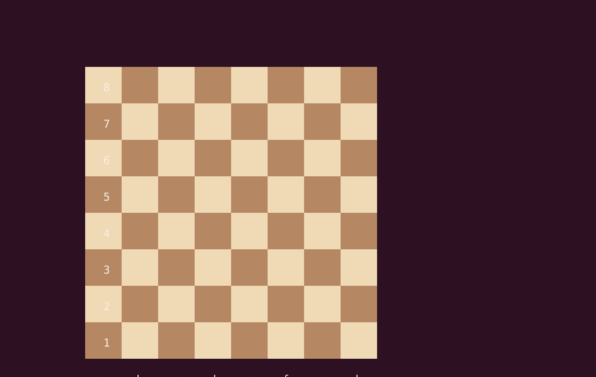

# Project-Chess
Chessy is a lightweight, pure Ruby chess engine designed to explore the mechanics of move generation, board representation, and evaluation. Built from scratch without external dependencies, it combines the elegance of Ruby with classic computer chess algorithms to calculate smart, strategic moves on the board.

## Current Display Output

