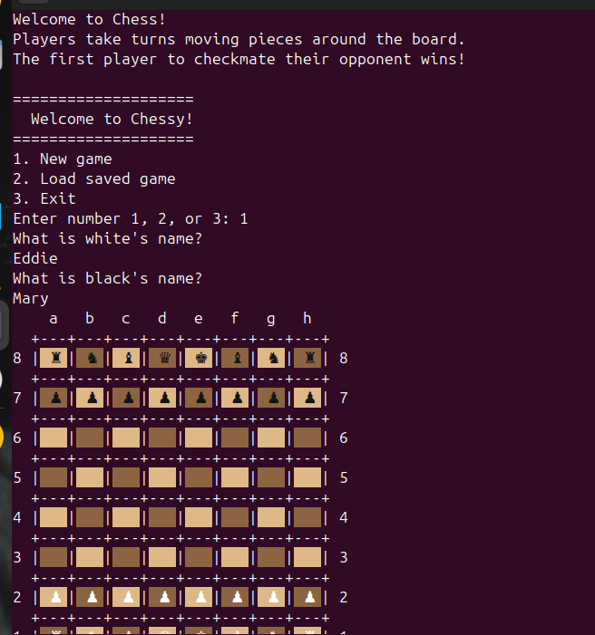
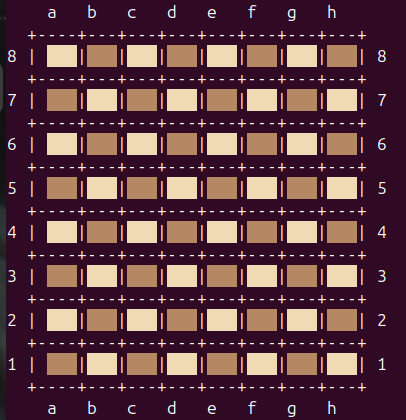
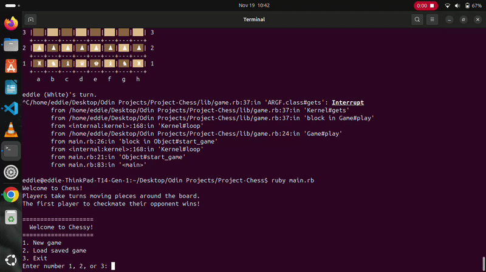

# Chessy ♟️

**Chessy** is a command-line chess game built in Ruby, featuring two-player gameplay, complete chess rules, and the ability to save and resume games.

[View the repository on GitHub](https://github.com/edwin-create/Project-Chess)

## Features

- **Complete chess rules:** Legal move validation, check, checkmate, stalemate and draw detection.
- **Special moves:** Castling, en passant and pawn promotion.
- **Two-player gameplay:** Play locally with custom player names.
- **Save and resume:** Save ongoing games and load previously saved games.
- **Terminal display:** Unicode chess pieces, coloured squares and board coordinates.
- **Move validation:** Illegal moves are rejected, allowing players to try again.

## Requirements

- Ruby 3.4 or later
- Bundler (for running the test suite)

Chessy uses Ruby's standard library for gameplay and has no external runtime dependencies. RSpec is used for automated testing.

## Installation

1. Clone the repository:

   ```bash
   git clone https://github.com/edwin-create/Project-Chess.git
   ```

2. Navigate into the project directory:

   ```bash
   cd Project-Chess
   ```

3. Install the development dependencies:

   ```bash
   bundle install
   ```

## Running Chessy

Start the application from the project root:

```bash
ruby main.rb
```

## How to Play

1. Select **New game** from the main menu.
2. Enter the names of the White and Black players. Press Enter to use the default names.
3. Players take turns entering moves using chessboard coordinates.

### Entering Moves

Moves are entered as a source square followed by a destination square, separated by a space.

Examples:

```text
e2 e4
g1 f3
e7 e5
```

The game validates each move against the rules of chess. Illegal moves are rejected, and the player is prompted to try again.

### Main Menu

- **New game:** Start a new chess game.
- **Load saved game:** Resume a previously saved game.
- **Exit:** Quit Chessy.

### Saving and Loading Games

Chessy supports saving and resuming ongoing games.

- The `saves/` directory is created automatically when the first game is saved.
- Each saved game is stored in a separate file.
- Unique filenames prevent existing saves from being overwritten.
- Saved games can be loaded from the main menu.

Game state is serialized using Ruby's built-in `Marshal` module.

## Project Structure

The project follows a modular structure, with application code organised under `lib/` and automated tests under `spec/`.

- **`main.rb`** – Application entry point and main menu.
- **`lib/board.rb`** – Manages the chessboard, piece placement, movement validation and chess rules.
- **Piece classes** – Represent individual chess pieces and define their movement patterns.
- **`lib/game.rb`** – Coordinates gameplay, player turns, move execution and game-ending conditions.
- **`lib/player.rb`** – Represents players, including their names and colours.
- **`lib/display.rb`** – Handles terminal rendering, board coordinates, square colours and Unicode chess symbols.
- **`lib/game_serializer.rb`** – Handles saving and loading games.
- **`spec/`** – Contains RSpec tests organised into separate files for the project's classes.

## Design Decisions

Chessy uses object-oriented design to separate the responsibilities of the application.

The `Board` class deliberately owns the chess rules and board state, including movement validation, check detection, checkmate, stalemate, castling, en passant and pawn promotion.

Rather than distributing chess-rule enforcement across multiple classes, these responsibilities are kept together in `Board`.

The other classes have focused responsibilities:

- `Game` coordinates the flow of play.
- `Display` handles presentation.
- `Player` represents the participants.
- `GameSerializer` handles persistence.

This separation allows the different parts of the application to collaborate without unnecessarily coupling their responsibilities.

## Running the Tests

Chessy uses RSpec for automated testing.

Run the complete test suite from the project root:

```bash
bundle exec rspec
```

The test suite covers chess piece movement, board rules, special moves, game-state validation and game serialization.

## What I Learned

Building Chessy provided an opportunity to apply and strengthen several software engineering concepts:

- **Object-oriented programming:** Designing classes with clear responsibilities and using composition and inheritance.
- **Test-driven development:** Writing and running automated tests with RSpec throughout development.
- **Algorithmic problem-solving:** Implementing move generation, path validation, attack detection and legal-move evaluation.
- **State management:** Maintaining consistent game state across moves, turns and special chess operations.
- **Object references:** Understanding how multiple objects can collaborate through references to shared state.
- **Serialization and persistence:** Using Ruby's `Marshal` module to save and restore game objects.
- **Separation of concerns:** Structuring the application so that game logic, presentation and persistence remain distinct.

---

**Built with Ruby.**

## Current Display Output

### Main Menu


### Chess Board


### Gameplay
